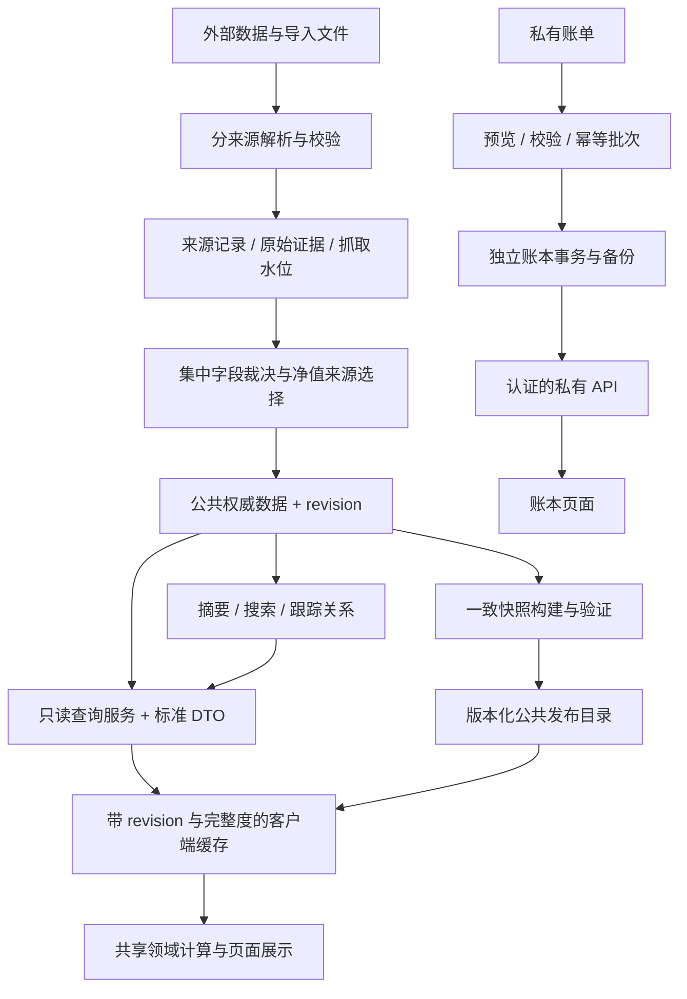

# FundCal 全面审计与优化路线图

> 优化进展：第一批已修复 A04 的内存缓存空值、A05 的查询编码及顶层异常处理、A18 的无效索引请求；新增 20 项回归测试，全量 251 项通过。各审计项的剩余内容与后续批次见 [执行记录](../../optimization-progress.md)，下文保留原始审计结论。

> 后续范围调整（2026-09-05）：按用户要求，账本功能及其前后端、样式、解析器、测试已全部移除，私人数据库迁出项目目录并保存一致备份。A03、A13 及账本扩展计划随功能退役关闭；A01 的仓库根目录暴露、A02 的公开爬虫接口仍待处理。下文和 JSON 证据保留删除前的历史审计结论，不代表当前功能清单；已删除源码的链接仅用于历史定位。`probes.mjs` 已移除退役模块依赖，当前仅复现剩余功能。

移除后验证：剩余 231 项测试全部通过；运行中的账本 assets/transactions/positions/settings 接口均返回 404，旧数据库/WAL 与页面模块路径返回 404；基金列表、净值范围及晨星接口仍返回 200。共享 Excel 库继续用于计算器导入，A17 仍然有效。

审计日期：2026-09-05。基线：`582edab` 加审计开始时的未提交改动，包含新账本、晨星快照、搜索和净值图改动。本文审计的是当前工作区，不代表该提交本身或公网部署版本。

**结论：保留现有原生 JS、Node 和 SQLite 主体，先修访问边界与数据正确性，再收敛数据契约、更新流程和性能热点。** 普通分页和按基金取净值已有良好基础，当前没有证据支持为了性能立即重写框架或迁移整个数据库。

本次归并为 **24 项：2 项 P0、15 项 P1、7 项 P2**。P0 应立即处理；P1 应在对应功能进一步扩展前处理；P2 纳入后续整理。优先级是本项目的处理顺序，不是 CVSS 评级。

## 1. 范围、方法与限制

- 检查七个页面的入口、共享数据层、费用及净值计算、HTTP 路由、数据库写入和迁移、Tushare/东财同步、字段裁决、静态构建、晨星导入、账本导入、定时任务、部署和依赖。
- `npm test`：**255/255 通过**，无跳过。主要覆盖纯函数、SQL builder、解析器和图表配置；不能据此推断 HTTP、IndexedDB、更新任务或业务闭环正确。
- `npm audit --json`：npm 依赖树报告 **0 个已知漏洞**。它不覆盖 HTML 直接加载的 CDN 脚本及手工 vendored 文件。
- 数据基线与 SQL 查询使用独立 `better-sqlite3` **readonly** 连接，不调用正式库的 `getDb()` 迁移，不运行抓取、裁决、重建、VACUUM、修复或删除。
- 写入复现均在系统临时目录复制代码并创建空白测试库；结束后删除临时目录。没有导入、删除或导出用户实际账本流水。
- 本地 HTTP 验证只读；私有文件仅检查 HEAD 响应，不保存文件正文。对格式错误请求只调用隔离路由，未向正在使用的 API 发出崩溃测试。
- 浏览器对计算器、列表、指数选基、统计、净值比较和基金详情进行了基本加载检查，非完整 E2E、无移动端与跨浏览器验证。账本以代码及隔离数据验证。
- **未验证 Cloudflare Access、Tunnel ingress、域名缓存规则、实际 OS 调度器和异地备份。** 下述本地暴露已确认；公网能否绕过认证访问这些路径，仍需检查边缘配置。未进行公网扫描、并发压测、全库完整性扫描或恢复演练。
- 没有修改业务代码、已有文档、部署设置和生产业务数据。新增文件都在本审计目录。

复现与原始记录：

| 文件 | 用途 |
|---|---|
| [probes.mjs](/Users/ziva/projects/FundCal/docs/audits/2026-09-05/probes.mjs) | 缓存、统计、账本、HTML 输出、空库构建及 crawler 写入的隔离复现 |
| [probes.json](/Users/ziva/projects/FundCal/docs/audits/2026-09-05/probes.json) | 复现输出；记录缺陷现状，不是通过断言的回归测试 |
| [benchmark.mjs](/Users/ziva/projects/FundCal/docs/audits/2026-09-05/benchmark.mjs) | 正式公共基金库的只读规模、覆盖率、查询计划与微基准 |
| [benchmark.json](/Users/ziva/projects/FundCal/docs/audits/2026-09-05/benchmark.json) | 每项 5 次串行样本及执行计划 |
| [http.json](/Users/ziva/projects/FundCal/docs/audits/2026-09-05/http.json) | 本地接口时延、响应大小及访问边界检查 |
| [search-experiment.json](/Users/ziva/projects/FundCal/docs/audits/2026-09-05/search-experiment.json) | SQL 关联顺序的只读对照实验 |

在仓库根目录可运行 `node docs/audits/2026-09-05/probes.mjs` 与 `node docs/audits/2026-09-05/benchmark.mjs`。后者扫描部分大索引，安排在低负载时重跑；无需真实账本内容或外部 token。已保存的数据是此次观测，不会随之后修复自动更新。

## 2. 当前规模与已有优势

| 指标 | 观测值 |
|---|---:|
| 主数据库文件 | 约 4.1 GiB；data 目录约 4.4 GiB |
| fund_basic / fund_meta | 各 34,948 行 |
| `.OF` 基金行 | 32,388 |
| fund_nav | 36,859,679 行 |
| index_basic / index_daily | 12,468 / 590,186 行 |
| 晨星快照 / 记录 | 8 期 / 155,013 行 |
| crawler/both 基金 | 28,188 行 |
| sync_log | 128,814 行 |
| 最新净值日期 | 2026-09-04 |
| 交易日历覆盖末日 | 2026-12-31 |

按 `status=L`、`.OF`、非货币基金统计：25,430 只中 375 只无净值，429 只最新净值早于 2026-08-29；24,917 只最新记录来自东财，其中 291 只落后于上述阈值。28,188 条 crawler/both 元数据中，1,196 条超过 30 天未更新。**这些是可用性标记，不能直接认定都是抓取失败**，仍需考虑披露延迟、暂停、QDII 和状态数据等因素。

已存在的设计值得保留：

- Tushare 与 crawler 影子字段及集中裁决；此次名称、类型与 crawler 影子的差异计数均为 0。
- `.OF` 优先的通用解析函数和按 `(ts_code,end_date)` 的净值主键。
- 列表服务端分页、参数绑定、排序白名单、页面 AbortController。
- 计算模块独立于 DOM，测试运行成本低；指标注册表已有扩展边界。
- 晨星历史独立存储、按当期分类比较、保留缺失，不覆盖现行费率；导入带来源文件和哈希信息。
- 账本与公共基金数据库分开，具备进一步隔离私有业务的基础。

## 3. 优先处理的缺陷

### A01 · P0 · 静态服务能访问私有数据库与仓库内部文件【本地已验证】

[dev-server.js:37](/Users/ziva/projects/FundCal/scripts/dev-server.js:37) 使用 `serve .`，`npm run serve` 同样以仓库根目录为根。本地 HEAD `/data/portfolio.db`、`/data/portfolio.db-wal`、`/.git/config`、`/scripts/nav/db.js` 均为 200。`.env` 此次为 404；主库 HEAD 超时，未据此声称主库下载成功。

风险是私有账本、WAL、源码及未来新增文件跟随静态根目录暴露。`.gitignore` 只能防止 Git 收录，不能控制 HTTP 访问；目前它还没有忽略 `portfolio.db` 及 WAL/SHM，工作区将这些文件列为未跟踪。

**处理与验收：** 建立仅包含 HTML/JS/CSS/vendor/明确公共数据的 `public` 或发布目录；把业务数据库、原始导入、日志和审计材料移出静态根目录。API/静态服务默认绑定 loopback。私有路径及目录枚举 GET/HEAD 均拒绝，公共页面保持可用，再核对 Tunnel 对该发布目录的映射。将全部私有 DB、WAL/SHM、导入文件纳入忽略规则。

### A02 · P0 · 个人账本与爬虫管理接口没有身份边界【本地只读验证＋代码确认】

[serve-fund-api.js:67](/Users/ziva/projects/FundCal/scripts/serve-fund-api.js:67) 对所有路由返回 `Access-Control-Allow-Origin: *`，允许 POST/PUT/DELETE，监听未指定 host。[portfolio-api.js:44](/Users/ziva/projects/FundCal/scripts/portfolio/portfolio-api.js:44) 直接提供共享账本读写，无身份验证和归属检查。携带外站 Origin 的无认证 `/api/portfolio/settings` 返回 200、CORS `*`、无 Cache-Control。

基金 `POST /:code/crawl` 每次启动子进程，没有队列、去重、调用配额。风险包括私有数据读取/篡改与资源耗尽；公网影响取决于未核实的边缘访问控制。

**处理与验收：** 分开公共只读 API、私有账本 API、管理任务 API。单人使用也要有可靠认证边界，不能依赖 CORS 充当鉴权；限定 Origin/Host，私有响应 `no-store`。抓取改为有界队列、同 code 去重和任务状态。用临时库验证未认证读写均拒绝、认证操作正常、重复抓取不会创建多个任务。

### A03 · P1 · 账本展示存在存储型 HTML 注入路径【隔离已复现】

[view-overview.js:45](/Users/ziva/projects/FundCal/js/pages/portfolio/view-overview.js:45) 将 `base_asset`、code、name、currency、asset_class、错误消息直接拼入 `innerHTML`。API 可写入这些字符串；隔离渲染证明标的名称中的 `<b>AUDIT_MARKER</b>` 作为标签进入输出。未在实际页面执行恶意脚本。

**处理与验收：** 用户或外部数据默认 `textContent`，确需模板时统一转义；复核导入预览中的 code 等字段。含 `< > & " '` 的标的、设置与错误消息只按文本显示。CSP 可作补充，不能替代输出编码。

### A04 · P1 · 缓存第二次读取返回 undefined【隔离已复现】

[idb-cache.js:112](/Users/ziva/projects/FundCal/js/data/idb-cache.js:112) 读取 `mem.data`，实际所有写入使用 `{key,body,etag,savedAt}`。复现：首调返回对象，第二次 `source=memory` 且 `data===undefined`，网络只请求一次。

影响搜索、统计、联接索引等跨页面复用；页面可能把缓存错误变成空列表。注释称 SWR，但过期分支实际等待网络，没有先返回旧值并后台更新；`maxAgeMs` 也没有阻止离线使用无限期旧数据。

**处理与验收：** 统一缓存记录字段和返回类型，明确 freshness/stale/失效语义。至少测试首次网络→内存、IDB→内存、304→内存、fallback→内存、离线过期和并发去重这些状态转换。

### A05 · P1 · 畸形查询参数可能使整个 API 进程退出【隔离路由已复现】

[fund-api.js:520](/Users/ziva/projects/FundCal/scripts/fund-api.js:520) 在路由 try/catch 之外调用手写 `decodeURIComponent`。`q=%` 触发未捕获的 `URIError`；顶层 async HTTP listener 没有统一 catch，在当前 Node 默认未处理拒绝策略下可导致进程退出。没有对正在使用的服务执行该请求。

手写解析还把 `URLSearchParams` 编码的空格 `+` 保留为加号，并截断值中的 `=`。NAV history 与账本 list 的 limit 只限制上界，负值在 SQLite 中会取消 LIMIT。

**处理与验收：** 集中使用标准 URL 查询解析和 schema 校验，顶层捕获异常；所有分页值有上下界，非法请求返回 400。错误请求后健康端点仍可响应，带空格搜索与前端搜索保持一致。

### A06 · P1 · 赎回边界与交叉点定义不一致【代码确认＋隔离复现】

[crawl-fund-fee.js:22](/Users/ziva/projects/FundCal/scripts/crawl-fund-fee.js:22) 将“小于7天”存成 `to:7`；[fee-calculator.js:27](/Users/ziva/projects/FundCal/js/domain/fee-calculator.js:27) 使用 `holdDays <= to`。详情又把它显示成 `<7天`。因此第 7 天的计算和展示规则相反，其他分段边界也有同类问题。

`findCrossoverPoints` 对阶梯跳变线性插值并取整。样例 A 第 7 天前 1.5%、之后 0，B 恒为 0.1%，返回第 8 天“交点”，但该天两者分别为 0 和 0.1%，并没有相等。

**处理与验收：** 显式记录区间开闭、时间单位；区分“费用相等日”和“成本优劣切换日”。先约定自然日/持有日与月年换算口径，再为 6/7/8、29/30/31、年界、连续交点和离散跳变建立金样。当前模型是线性累计费率估算；金额阶梯和真实现金流应作为明确的后续模型，不能悄悄改变现有输出意义。

### A07 · P1 · 局部抓取可能删除其他费率类别；零值与缺失混用【隔离已复现】

[db.js:633](/Users/ziva/projects/FundCal/scripts/nav/db.js:633) 只要任意一组分段非空，就删除该基金全部 fee_segments，再写本次出现的组。复现：原有 purchase/redeem/sell，本轮只有 sell，最终只剩 sell。crawler 对未解析到赎回表还会生成永久 0 费率，使这一覆盖路径尤其容易被触发。

[db.js:602](/Users/ziva/projects/FundCal/scripts/nav/db.js:602) 把总费率 0 视为缺失，组件费率却允许写 0。复现：组件全变 0，总费率/年费仍保留 0.01。当前正式库中该组件加总差异计数为 0，不能把隔离情景说成已发生的数据损坏。

**处理与验收：** 每个字段/费率 kind 区分成功解析、真实空集合、缺失、失败；按 kind 原子替换，并允许真实零费率。错误页、缺少一张表、部分子请求失败时保留对应旧数据并标记其日期，不把失败包装成新鲜的零费率。

### A08 · P1 · 买入分段在入库和页面读取两处丢失契约【代码确认】

crawler 提取 `amountCondition`、`periodCondition`、`rateDiscount`，但 [db.js:152](/Users/ziva/projects/FundCal/scripts/nav/db.js:152) 的分段表仅保存 kind/seq/to_days/rate。金额阶梯、固定费用、原始条件无法重建。

API 输出 `purchaseFrontSegments` 等字段，[fund-detail/index.js:211](/Users/ziva/projects/FundCal/js/pages/fund-detail/index.js:211) 却读取 `buyFeeSegments/purchaseSegments/buySegments`，即使有数据也显示“无买入分段”。金额阶梯也不能用通用“持有期”表来表示。

**处理与验收：** 定义唯一 FeeSchedule DTO，包含适用金额/持有期、开闭边界、费率或固定金额、币种及来源文本。先补幂等迁移与序列化，再修页面。HTML fixture→DB→API→详情的往返必须保留条件、折扣和缺失信息。

### A09 · P1 · crawler 与部分查询绕过 .OF 优先规则【隔离已复现；当前数据未显示误写】

[db.js:515](/Users/ziva/projects/FundCal/scripts/nav/db.js:515) 用 `WHERE code=?` 的第一行确定 crawler 写入目标，不调用 `codeToTsCode`。先插 `.SH` 再插 `.OF` 的隔离样例中，通用解析器返回 `.OF`，crawler 却写 `.SH`。`loadOne` 及 NAV basic/name 查询也有无顺序的同 code 查询。

当前有 1,953 个多行 code；crawler/both 的场内行和重复 code 均为 0，因此这是一条可触发的完整性缺陷，不是对当前误写数量的宣称。`sync-fund-nav --all` 也没有限制 `.OF`，且通用解析器在只有场内行时仍会返回场内代码。

**处理与验收：** 公共业务统一使用严格的场外标识解析；审计用途显式另设入口。覆盖仅场内、两者都有、插入顺序相反、仅占位行等样例，确保同步和写入都不会落到 `.SH/.SZ/.BJ`。

### A10 · P1 · 标准定时流水线不能保证持续更新及失败可见【代码确认】

[cron:23](/Users/ziva/projects/FundCal/scripts/cron/fundcal-cron:23) 每日只用东财 `--missing`；该模式排除已有任何 NAV 的基金。因此初次补上后，若 Tushare 持续没有该基金数据，日常流程不再为它补后续日期。

[cron:36](/Users/ziva/projects/FundCal/scripts/cron/fundcal-cron:36) 周爬虫没有 `--force`，只处理从未抓过的基金；且传 `--concurrency 5`，解析器只识别 `--concurrency=5`，实际回退默认值。任务按固定时钟触发，没有前置成功依赖和全局锁；还使用历史 Linux `/var/www/fundcal` 路径，不能据此断言 Mac 当前已安装该计划。

[sync-fund-nav.js:189](/Users/ziva/projects/FundCal/scripts/nav/sync-fund-nav.js:189) 抓取失败后返回 0，上层仍 `successCount++`，最终正常退出；重放脚本也会吞掉批失败。调度器无法据退出码可靠识别失败。

**处理与验收：** 统一到一个编排入口和一致的 CLI 解析；按真实依赖执行基础信息→抓取→裁决→派生→校验→发布。建立持续兜底集合、逐基金水位和任务状态，允许数据缺口但显式记录 partial。模拟失败、延迟、重入、同日重跑和补过一次的基金，检查退出码、重试集合与发布状态。

### A11 · P1 · 周/月采样与统计频率不匹配【隔离已复现】

[nav-stats.js:40](/Users/ziva/projects/FundCal/js/domain/nav-stats.js:40) 对不足 800 行的序列忽略 weekly/monthly，调用方仍按请求 interval 年化波动率。100 行日数据请求 weekly 时仍返回 100 行，但波动率为日频计算的约 **0.4543 倍**。现有测试分别认可“小样本不降采样”和“weekly 用 √52”，缺少组合验证。

增量补几十行时同样容易把 daily 数据并入已有 weekly 缓存；同一份缓存内出现混合频率。基于抽样数据再计算最大回撤也会遗漏周期内低点。

**处理与验收：** 原始 daily 作为计算基准，显示降采样与统计分离；或返回并严格使用实际采样频率。周/月桶边界增量重算并替换整个桶，版本升级后失效旧缓存。短长历史、跨周补数、不同成立日期的对比必须一致。

### A12 · P1 · NAV 缓存无法表达内部缺口和历史修订【隔离复现＋代码确认】

[nav-api.js:181](/Users/ziva/projects/FundCal/js/data/nav-api.js:181) 用已有点的最早/最晚日期推断完整覆盖。复现：只缓存 1 月和 3 月，查询 2 月却返回“无缺口”。补齐的只读函数本身通过测试，组合后的覆盖假设错误。

缓存没有使用 updatedAt 作过期判断，也没有数据 revision；源端修订、复权重算和中间补洞不会被发现。请求从 1998 年开始，但基金后来才成立时，左侧空区间会重复请求。失败被吞成部分/空 series，UI 可能把网络错误显示成无数据。逐 code、逐 gap 串行请求进一步放大 RTT。

**处理与验收：** 保存已成功查询的覆盖区间与数据 revision，区分“查询成功无记录”和“查询失败”；近期窗口重验证，修订可失效历史。聚合相同范围的 codes 批量请求，返回每个标的状态。测试不相交区间、内部缺口、空前史、源修订、离线、IDB 不可用和并发合并。

### A13 · P1 · 账本缺少幂等导入与完整交易校验【隔离已复现】

[portfolio/db.js:174](/Users/ziva/projects/FundCal/scripts/portfolio/db.js:174) 只验证 date 非空和 type 枚举；`date='not-a-date'` 且没有交易腿的 trade 可入库。批量导入没有来源交易 ID、批次哈希或唯一键，同一笔重复导入会多记；[view-import.js:98](/Users/ziva/projects/FundCal/js/pages/portfolio/view-import.js:98) 按钮也没有提交中禁用。assets 在 transactions 事务外写入，交易失败可能留下半个导入。

[portfolio-ledger.js:77](/Users/ziva/projects/FundCal/js/domain/portfolio-ledger.js:77) 仅显式给 fee_asset 才扣费，与数据库“默认 currency”的注释不符。100 CNY 买入支出 50、fee=2、currency=CNY 未给 fee_asset 时，剩余现金是 50 而非 48。纯函数也不规范化字符串数量；这属于额外防御性缺口，SQLite REAL 正常往返会转换合法数值字符串，不等同于所有 API 字符串都会错误相加。

**处理与验收：** 统一交易 schema、日期/有限数值/交易腿/币种/资产校验；导入批次和来源行 ID 提供幂等性，assets+transactions 同事务，提供预览和可逆批次撤回。明确费用默认币种与成本计入规则。暂时把未实现的多币种估值、期货保证金和 TWR/XIRR 保持为独立后续能力；不能将混合币种成本直接当总资产或收益基础。

### A14 · P1 · 空库不能直接构建，运行环境声明不可靠【隔离已复现】

[build-allfund-from-db.js:129](/Users/ziva/projects/FundCal/scripts/build-allfund-from-db.js:129) 依赖 `m.share_class`，但该列只由单独 `parse-share-class.js` 添加，未纳入 `getDb()` 幂等迁移。新建库执行 builder 得到 `no such column: m.share_class`、退出 1。

项目宣称 Node 18+；当前安装的 better-sqlite3 12.9.0 的 engines 不含 18。`pinyin-pro` 运行时被 API 导入却放在 devDependencies，`npm ci --omit=dev` 缺少它。`serve` 经 npx 临时解析，不在 lockfile。Tushare 节流常量在模块导入时读取 env，入口稍后才 `loadEnv()`，因此 `.env` 中这些参数可能不生效（token/url 是调用时读取）。

**处理与验收：** 所有 schema 变更集中登记幂等迁移；公共库路径可注入，API 只读连接与 ETL 写连接分开。固定支持的 Node 和工具版本，调整运行时依赖、统一配置加载时机。CI 使用空库跑迁移→构建，并执行 production-only 安装后的 API 启动检查。

### A15 · P1 · 增量水位混合来源，缺少修订与来源优先级约束【代码确认】

Tushare 和东财都从整个 fund_nav 的最新日加一开始。东财已把末日推进后，Tushare 恢复也不会补回这些日期的主源记录及缺失字段。全量写入 [db.js:360](/Users/ziva/projects/FundCal/scripts/nav/db.js:360) 使用 `INSERT OR REPLACE`，没有按 source 优先级保护，后跑的来源覆盖前者。指数日线也使用共享日期键，需要同类治理。

现在东财已是大部分存续基金的最新来源，文档中“仅补 Tushare 零行基金”的旧描述与现行 `--all` 续接不符。东财复权算法已经注意沿用 anchor，但若 anchor 到首个新点中间有遗漏，reported daily return 不能当然替代整个区间回报；不能把几项样例测试等同于所有分红/拆分序列完全等价。

**处理与验收：** 定义逐来源抓取水位、权威选择和 revision；保留原始采集证据或足够的来源历史。采用可配置回看窗口，主源恢复时可替换兜底并触发客户端失效。金样覆盖普通日、现金分红、拆分、数据缺日、历史更正及主源恢复。

### A16 · P1 · 同步热点查询会阻塞其他请求【只读测量确认】

`hs300` 搜索经过 JS 匹配后，[list-query.js:84](/Users/ziva/projects/FundCal/scripts/list-query.js:84) 的计划先扫描按 source 筛选的 meta，再扫描 json_each 匹配集合，重复嵌套工作。相关搜索＋count＋分页约 590 ms。仅更换为匹配集合先驱动 code 索引，SQL 部分可约 0.6 ms，见性能节。

[nav-api.js:49](/Users/ziva/projects/FundCal/scripts/nav/nav-api.js:49) 的 distinct 统计扫描 3,685 万行覆盖索引，5 次中位约 929 ms。better-sqlite3 同步执行会阻塞同一进程中的其他 API。[http-cache.js:48](/Users/ziva/projects/FundCal/scripts/nav/http-cache.js:48) 在查询、聚合、序列化都完成之后才算 ETag，所以 304 只减少传输，不能省掉这些源站计算。

**处理与验收：** 优先修查询驱动顺序、缓存 search index 的版本化结果、构建逐基金 NAV 摘要和全局统计快照；热点响应以 data revision 做内存缓存。完整保留匹配排序、筛选和分页语义。用小规模并发验证昂贵请求不会把普通查询拖慢，再决定是否需要 worker/process 隔离。

### A17 · P1 · HTML 中的 SheetJS 版本含已披露漏洞，npm audit 不会发现【代码＋官方公告】

[index.html:920](/Users/ziva/projects/FundCal/index.html:920) 从 CDN 加载 `xlsx@0.18.5`，导入在浏览器主线程读取整个 workbook。SheetJS 官方确认至 0.20.1 的版本受 CVE-2024-22363 ReDoS 影响，修复版本为 0.20.2 或之后。恶意或异常导入文件可能造成解析阻塞；本次未执行漏洞利用。[官方公告](https://cdn.sheetjs.com/advisories/CVE-2024-22363)

**处理与验收：** 从官方发行渠道选择经核查的修复版本，固定版本和校验信息，并把 CDN/vendor 纳入依赖清单。导入页按需加载，限制文件大小、工作表/行数，必要时 Worker 解析并支持取消。正常账单样例输出一致，超限或异常文件有明确失败状态。

## 4. 数据流与维护优化

### A18 · P2 · 资源地址和多套 DTO 不一致【部分 HTTP 已验证】

[nav-api.js:90](/Users/ziva/projects/FundCal/js/data/nav-api.js:90) 请求 `/api/index-search-index`，实际端点是 `/api/nav/index-search-index`，前者确认 404。`fetchFeederIndexFromAPI` 请求不存在的 `/api/fund/feeder-index`，每次网络回源都先失败再读静态。

API 与静态分别维护对象转换：source 的 `both` 被静态改成 `eastmoney`，shareClass/status/lifecycle/needsCrawl 和日期 fallback 不一致；搜索 API 排除占位行，静态却包含。`transformApiDataToFundConfig` 还丢掉 establishmentDate，计算器详情表读不到它。列表只靠 page/q/sort 的“真值”选择响应类型，单传 size/filter 可能走旧全量数组路径。

建议一个端点清单、一个公共 Fund DTO serializer、一个搜索与筛选契约；只有真实存在的端点才请求。静态明确承担离线快照，返回 `source/asOf/stale` 等状态而非静默替代。测试 API 与同 revision 快照的契约一致。

### A19 · P2 · 构建与发布缺少一致快照【代码确认】

builder 分开读取 meta、segments、returns，未包裹一致读事务；逐个覆盖现有分片，不删除已失效分片，不做版本目录切换。部分失败、进程终止或并行 crawler 写入时可能形成混合代次。单只 crawl 仅写影子和明细，不调用单基金裁决或刷新静态/缓存，可能呈现新费率配旧名称。

建议抓取事务产出后做集中/单基金裁决，更新 data_revision 和受影响集合；基于一致读快照构建临时版本目录、校验、原子切换 manifest，保存上个版本以便回滚。故障注入验证读取者只能看到完整旧版或新版。

### A20 · P2 · 页面异步生命周期仍有竞态【代码确认，未浏览器故障注入】

[router.js:42](/Users/ziva/projects/FundCal/js/core/router.js:42) 切换过程中直接丢弃新请求；慢 import 时连续切页可能让 hash 与实际激活页面分离。`pageInit()` 若返回 Promise 未 await，失败后仍可能标记 initialized。

[nav/index.js:615](/Users/ziva/projects/FundCal/js/pages/nav/index.js:615) 没有 AbortController/请求代号，旧响应可覆盖最新选择；详情主 loadFund 有版本检查，但其净值和 peers 子请求没有同等保护。建议统一 `mount/activate/deactivate/dispose`，页面请求具备代号与取消，路由使用“最后一次请求生效”，离开页面停掉不必要的 observer/渲染。

### A21 · P2 · 请求放大、首屏资源与大模块是前端主要整理点【代码及规模确认】

指数选基一次 `Promise.allSettled` 最多请求 220 只详情，并且在全局排序之前截断，Top10 只是已加载子集的排序（页面虽提示截断，仍不适合后续做全库推荐）。统计页 API 故障回退会为整个分组并发请求单只详情。NAV 则反过来逐只串行拉 MAX 日数据；修复空前史缓存后再评估其代价。

首屏无条件同步载入 Chart.js、annotation、ECharts，vendor 共约 1.2 MiB；SheetJS 也无条件加载，CSS 约 26 个 import 加外部字体。页面 module 懒加载没有覆盖这些大资源。NAV 入口 2,339 行、calc 1,184 行、stats 746 行；计算器每次更新销毁并重建图表，交叉点计算内部反复排序分段。

建议先增加按 codes 的批量详情、服务端“按指数筛选并排序分页”，统一有界并发；按路由加载图表/导入库，缓存和更新现有图实例。NAV 拆成数据控制、持久状态、图表构造、交互、统计呈现；calc 拆状态、费用模型、图表和详情。不需要同时引入前端框架、全局 store、另一套图表库。费用分段归一化一次，使用分段解析求交与优劣区间。

### A22 · P2 · 备份与持续集成缺少可恢复性验证【文档与配置确认】

DEPLOY 的 `checkpoint` 后 `cp` 指引没有明确停止全部写入，也没有备份账本。checkpoint 与复制之间若继续写入，不能保证得到一致快照。SQLite 官方提供 Online Backup API 和 VACUUM INTO 用于运行中数据库的备份。[SQLite 官方备份说明](https://www.sqlite.org/backup.html)

`.github/workflows/deploy-pages.yml` 仍在 main push 时上传整个 checkout，没有安装、测试、构建门禁；与当前 Tunnel 部署目标不符。不能从该文件断言 GitHub 上已启用或最近部署成功。

建议公共库与账本分别使用一致备份、保留策略、离机副本和定期恢复检查；把恢复成功作为迁移前置条件。确认是否保留 Pages，若已退役就移除对应 workflow 与死兼容代码。CI 补固定 Node 的 npm ci/test、空库迁移构建、API 契约和少量 E2E。不要让工作区私有文件进入任何发布 artifact。

### A23 · P2 · 健康检查对“部分陈旧”失明【代码与数据确认】

C5/C6 用全表 MAX 判断新鲜度，一只更新就可能掩盖其余陈旧；此次 NAV 最新日为昨日但仍有 429 只存续非货币场外基金超过 7 天阈值。缺失、空表、无近期任务也不一定形成失败状态。C4 未按货币产品口径分组；C9 benchmark 比较未复用裁决归一化，可能把符号差异当待裁决。缺少指数、晨星、构建 revision、磁盘/WAL、备份年龄及 API 时延的检查。

建议以逐基金/指数摘要和交易市场日历计算新鲜度分布，输出 missing/stale/failed/skipped 与原因；校验统计与裁决使用同一规则。日志增加 run_id、code、source、rows、duration、error_kind。任务无运行记录、连续 0 行、覆盖率下滑应可观测。

### A24 · P2 · 扩展前需统一产品口径与领域边界【设计审计】

净值图的日期并集统一经 SSE 日历过滤，会删掉港/美指数在 A 股休市日的合法点。统一图轴、forward-fill 对显示有用，但应与各市场原始收益统计分开；明确共同区间/各自区间、价格指数/全收益指数、复权/单位净值、停牌/缺数及填充来源。

建议明确四个领域：基金目录与契约费用、净值与业绩分析、晨星历史参考、私有账本。保留不同业务的来源与单位，不让“基金六位 code”承担所有资产的身份。统一 Date/Rate/Money/InstrumentId 的数据约定，以 JSDoc/运行时校验渐进加强即可。共享搜索组件、FeeSchedule、标准 Fund DTO、统计口径和请求层；避免在各页面重新推断字段或补零。

## 5. 性能基线与优化顺序

Node v24.16.0，本机低并发，DB/OS 缓存可能已热。SQL 项为 5 次串行中位数，不是 HTTP p95；HTTP 是单次回环观测；费用计算是合成压力场景，不是浏览器交互实测。

| 工作负载 | 观测 | 判断 |
|---|---:|---|
| 默认列表 count＋第 1 页 | 17.94 ms | 基本路径健康，暂不需要更换存储 |
| 年费排序 count＋第 1 页 | 18.52 ms | 有临时排序，但不是当前首要瓶颈 |
| code 搜索预构索引匹配＋SQL | 14.07 ms | 与真实 HTTP 仍有额外索引读取/序列化开销 |
| `hs300` 搜索预构索引匹配＋SQL | 589.98 ms | 优先修查询计划 |
| “基金”宽搜索 | 377.52 ms | 搜索结果集合驱动 SQL，核实宽查询成本 |
| NAV distinct 基金数 | 929.08 ms；首次 3,794.81 ms | 全索引扫描应移出请求热路径 |
| `000001.OF` 全部净值取数 | 1.08 ms | 现有联合主键有效 |
| 20 基金、7,300 天，两两交叉点 | 153.58 ms | 主线程反复计算会影响交互，分段求解更合适 |
| HTTP 列表 100 行 | 56.77 ms / 72,941 bytes | 仅本机单次观测 |
| HTTP 搜索索引 | 48.4 ms / 2,333,723 bytes | 传输/解析/多页重复加载值得优化 |

只读 SQL 实验把 builder 中的 `FROM fund_meta m JOIN json_each(?) search_match ON search_match.value = m.code` 替换成 `FROM json_each(?) search_match CROSS JOIN fund_meta m ON m.code = search_match.value`。计划转为 json_each→`idx_fund_meta_code`→basic，5 次 SQL count＋分页为 1.70/0.67/0.62/0.59/0.58 ms，样例第一页结果完全相同。**实验不包含 JS 搜索和 loadSearchIndex，也未验证所有组合；不能宣称整个接口已获得同等加速。** 后续需在真实筛选、宽查询和分页上做等价验证后再落地。

优化顺序：缓存错误与地址→SQL 计划→摘要与响应缓存→批量接口/并发→图表增量更新及按需资源→有证据时再做 Worker 或冷热存储。不要为了此次扫描盲目给 3,685 万行加多个索引；索引的写放大、磁盘与实际查询收益须一起测量。

Parquet 保留为时间序列冷归档候选。当前单标的点查很快，适合先做独立样本实验，验证压缩、范围查询、修订、备份及 SQLite 兼容查询层，再决定范围。可先引入 `fund_nav_summary` 派生表，避免为 count/range/freshness 扫整张历史表。

## 6. 目标数据流

不要求一次实现图中全部新表。先形成数据契约、可观测任务和版本号，再用最少字段支撑已确认的修复。公共基金读取与私有账本必须保持不同的认证、发布和备份边界。

## 7. 可直接实施的分批计划

| 批次 | 范围 | 完成标准 | 相对工作量 |
|---|---|---|---|
| 1：访问边界 | A01–A03、A05 的顶层错误边界 | 私有文件拒绝访问；匿名账本读写拒绝；HTML 按文本显示；坏请求不影响服务 | 中 |
| 2：用户可见正确性 | A04、A06、A08、A11、A18 | 缓存状态转换、费率边界、DTO 往返、实际采样频率全部有金样验证 | 中至大 |
| 3：数据更新可靠性 | A07、A09、A10、A14、A15、A19 | 空库可启动构建；来源不串写；失败可见；兜底持续更新；发布有 revision 可回滚 | 大 |
| 4：账本可靠性 | A13、A17；先完成私有隔离 | 导入去重、全事务、错误可定位、费用规则明确、修复解析依赖 | 中至大 |
| 5：性能优化 | A16、A21 | 基准前后可比；搜索语义相同；普通请求不被统计阻塞；请求数量有上限 | 中 |
| 6：结构与运维整理 | A20、A22–A24 | 页面生命周期规范、恢复演练、CI 门禁、现行文档唯一且可执行 | 持续分拆 |

实施时每批只改变一个明确契约，尽量先补失败金样再修复。已有未提交功能应先按主题整理为可回滚基线，避免把业务、数据重抓、性能重构与部署变更合成一个难审查的大改动。

建议目标而非已达成指标：代表性混合筛选的本地查询 p95 <100 ms；有热缓存的简单 API p95 <100 ms；输入与拖动避免持续 >50 ms 主线程任务；同 revision 重复查询不重复扫描历史大表；同批导入重复提交记录数不变。最终阈值应结合实际机器、数据规模与公网 RTT 定稿，并用固定数据集与少量混合并发验证。

## 8. 功能扩展的前置条件

| 扩展方向 | 先完成的基础 | 建议首个可交付范围 |
|---|---|---|
| 投资金额/渠道折扣/后端收费比较 | A06–A08，保留金额阶梯与边界 | 单笔、单币种、可解释的费用明细与优劣切换日 |
| 指数选基与全库筛选 | A09、A16、A18、A21 | 服务端完整集合排序、分页；展示费率/规模/收益的数据日期 |
| 多市场业绩与风险分析 | A11、A12、A15、A24 | 日频原始统计、统一比较区间、清晰区分价格/全收益指数 |
| 晨星长期比较 | A18、A19、A23 | 保留每期样本和分类、展示来源与快照缺失，继续独立于现行费率 |
| 账本收益、TWR/XIRR、多本位 | A01–A03、A13、A22 | 先做好单币种现货账本与快照对账，再引入估值和外部现金流分类 |
| 更多 K 线/资产/复杂指标 | 严格 InstrumentId、source/revision、摘要和冷热存储实验 | 独立数据适配器和范围查询契约，不扩张基金 code 的隐式含义 |

本次不建议先做全站框架迁移、全量数据库替换或大量抽象层。已有可复现缺陷和查询计划提供了更明确、可验证的改进路径。
